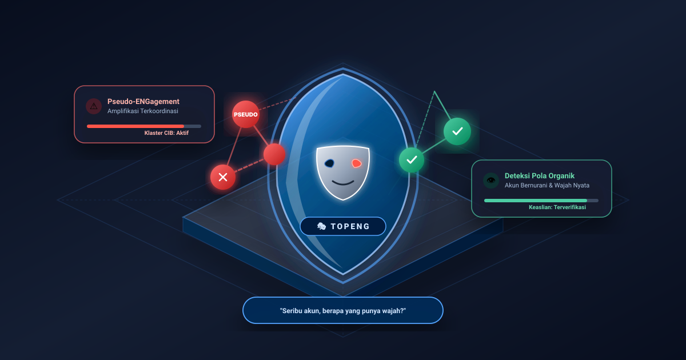
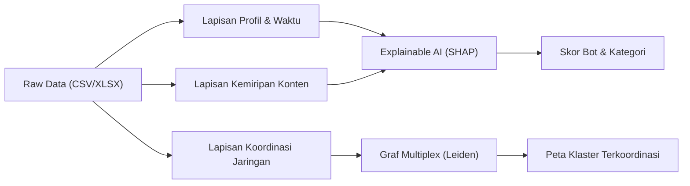

<p align="center">
  
</p>

<p align="center">
  <a href="https://github.com/digimetateam-hash/BOT-DETECTOR/stargazers"></a>
  <a href="https://github.com/digimetateam-hash/BOT-DETECTOR/network/members"></a>
  <a href="https://bot-detectortwt.streamlit.app"></a>
  <a href="https://www.python.org/downloads/"></a>
  <a href="#etika--privasi"></a>
</p>

---

# 🎭 TOPENG
### **Twitter Observer for Pseudo-ENGagement**

<br>

<div align="center">
  <blockquote>
    <h3><em>"Seribu akun, berapa yang punya wajah?"</em></h3>
  </blockquote>
</div>

<br>

Sebuah tagar meledak dalam semalam.  
Ribuan akun ikut bersuara, ramai, kompak, meyakinkan.  
Tapi ramai belum tentu nyata.  

Sebagian adalah orang. Sebagian lagi hanya topeng.  

**TOPENG** mengamati pola di balik keramaian itu, agar kita bisa bertanya:  
> **Siapa yang benar-benar bicara?**  

<br>

<div align="center">
  <h2><strong>Buka topengnya. Baca polanya.</strong></h2>
</div>

<br>

> [!WARNING]
> **Catatan Etika & Integritas Ilmiah:**  
> Hasil deteksi sistem ini adalah **indikasi berbasis pola perilaku matematis**, bukan vonis mutlak terhadap pemilik akun. Identitas akun disamarkan menggunakan enkripsi satu arah *SHA-256 + secret salt* demi melindungi privasi.

---

## 🌌 Di Balik Tirai: 4 Lapisan Sinyal Pembuka Topeng

TOPENG tidak menghakimi dari satu cuitan. Ia menyibak lapisan perilaku yang mustahil dipalsukan secara bersamaan:



<br>

<table>
  <tr>
    <td width="50%" valign="top">
      <h3>👤 1. Topeng Profil & Reputasi</h3>
      <p>Buzzer bayaran sering kali dibuat massal dan terburu-buru.</p>
      <ul>
        <li><strong>Rasio Follower/Following Ekstrem:</strong> Mengikuti ratusan orang, namun nihil pengikut organik.</li>
        <li><strong>Umur Akun Seumur Jagung:</strong> Dibuat beberapa hari menjelang isu memanas.</li>
        <li><strong>Wajah Tanpa Rupa:</strong> Avatar default telur/bawaan dan bio kosong tanpa riwayat hidup nyata.</li>
      </ul>
    </td>
    <td width="50%" valign="top">
      <h3>⏱️ 2. Denyut Waktu yang Terlalu Rapi</h3>
      <p>Manusia lelah dan beristirahat. Bot bergerak dengan jam kerja mekanik.</p>
      <ul>
        <li><strong>Entropi Jam Aktif 24 Jam:</strong> Pola penyebaran jam yang terpaku di titik tertentu atau aktif nonstop tanpa ritme sirkadian.</li>
        <li><strong>Keteraturan Burstiness:</strong> Jeda interval postingan yang terlalu seragam (terprogram otomatis via cron atau bot script).</li>
      </ul>
    </td>
  </tr>
  <tr>
    <td width="50%" valign="top">
      <h3>📝 3. Suara Kembar (Content Fingerprint)</h3>
      <p>Satu narasi, diketik oleh puluhan akun yang berbeda dalam hitungan detik.</p>
      <ul>
        <li><strong>MinHash & LSH (Jaccard &ge; 0.85):</strong> Membongkar template copy-paste pesan sponsor dalam sekejap mata.</li>
        <li><strong>Ketahanan Parafrase IndoBERT:</strong> Mendeteksi pesan yang sengaja diubah susunan katanya menggunakan AI/LLM agar tampak berbeda.</li>
      </ul>
    </td>
    <td width="50%" valign="top">
      <h3>🕸️ 4. Orkestrasi Bayangan (Multiplex Network)</h3>
      <p>Satu akun tampak biasa. Tapi 50 akun yang bergerak serentak adalah armada.</p>
      <ul>
        <li><strong>Co-Retweet Cepat (&le; 60 detik):</strong> Akun-akun yang selalu me-retweet target yang sama secara sinkron &ge; 3 kali.</li>
        <li><strong>Deteksi Komunitas Leiden:</strong> Mengelompokkan klaster terkoordinasi dan memisahkan <em>Akun Inti (Penyebar Narasi)</em> dari <em>Akun Pasukan Amplifikasi</em>.</li>
      </ul>
    </td>
  </tr>
</table>

---

## 🎨 Tampilan Dashboard Interaktif (Material Design 3)

Antarmuka web dashboard dibangun menggunakan prinsip **Google Material Design 3**, menyajikan 7 layar analisis terpadu:

1. **📥 Unggah Data:** Mendukung format ekspor NodeXL Pro (XLSX) dan CSV scraper, dilengkapi dataset simulasi isu **MBG (*Makan Bergizi Gratis*)**.
2. **📊 Ringkasan Isu:** KPI metrik cepat mengenai persentase akun mirip bot dan visualisasi tren waktu lonjakan cuitan.
3. **⚠️ Daftar Akun Berisiko:** Filter kategori (*Organik*, *Mencurigakan*, *Mirip Bot*) dengan slider skor sensitivitas.
4. **🔍 Detail Akun & XAI:** Grafik kontribusi fitur ala **SHAP Waterfall** (Top-5 penyumbang skor) dan sampel riwayat cuitan tersamar.
5. **🕸️ Peta Klaster Koordinasi:** Visualisasi graf jaringan interaktif untuk melihat siapa yang terhubung dengan siapa di setiap lapisan koordinasi.
6. **✍️ Validasi Manual Coder:** Sarana pelabelan independen untuk mengukur reliabilitas *Cohen's Kappa* ($\kappa \ge 0.70$).
7. **📑 Laporan & Ekspor:** Unduh korpus bersih teranonimkan untuk kebutuhan publikasi jurnal (Scopus/Sinta) atau rilis media.

---

## ⚡ Panduan Instalasi & Menjalankan Lokal

### 1. Kloning Repositori
```bash
git clone https://github.com/digimetateam-hash/BOT-DETECTOR.git
cd BOT-DETECTOR
```

### 2. Siapkan Virtual Environment (Python 3.11)
```bash
python3.11 -m venv .venv
source .venv/bin/activate  # Untuk Linux/macOS
# .venv\Scripts\activate   # Untuk Windows
```

### 3. Instal Seluruh Dependensi
```bash
pip install -r requirements.txt
```

### 4. Setup Kunci Rahasia (.env)
```bash
cp .env.example .env
# Edit SECRET_SALT di .env untuk salt hash akun Anda
```

### 5. Jalankan Aplikasi Web
```bash
streamlit run streamlit_app.py
```
Buka browser pada URL: **`http://localhost:8501`**

---

## 🔒 Etika, Keamanan & Privasi Data (PRD 13b)

- **Handle Hashing Wajib:** Username asli akun tidak pernah disimpan telanjang di database. Seluruh rekaman dienkripsi menggunakan formula:
  $$\text{Handle Hash} = \text{SHA-256}(\text{username} + \text{SECRET\_SALT})$$
- **Bahasa Non-Menghakimi:** Label publik menggunakan frasa *"perilaku mirip bot"* atau *"terindikasi terkoordinasi"*, menghindarkan dari jerat doxing atau pencemaran nama baik.
- **Transparansi 100%:** Peneliti dapat mereplikasi eksperimen dengan melihat parameter acak (`seed`) yang tercatat di tabel `run_model`.

---

<p align="center">
  <strong>🎭 TOPENG</strong> — <em>Karena di balik riuhnya linimasa, kebenaran pantas diperdengarkan tanpa rekayasa.</em><br>
  Dibuat oleh Tim Riset Digital Media & Kebijakan Publik Indonesia.
</p>
